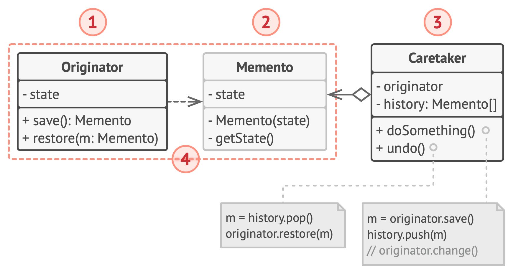

### Presentacion
https://canva.link/6wmrfl72aa8g2gr

### Estructura general



**Qué representa cada número de la figura:**

1. **La Originadora (Originator)** crea una instantánea (memento) de su estado actual y utiliza dicha instantánea para restaurar su estado cuando sea necesario.

2. **El Memento** almacena el estado interno de la originadora. Sus campos son privados e inmutables, lo que garantiza que solo la originadora pueda leerlos o modificarlos.

3. **La Cuidadora (Caretaker)** es la encargada de almacenar y custodiar el historial de mementos. Decide cuándo guardar o restaurar un estado, pero no puede acceder ni alterar el contenido interno de las instantáneas.

4. **El Cliente (Client)** solicita la creación de checkpoints y la restauración de los mismos a través del cuidador, sin manipular directamente los objetos de estado.

(El libro describe además dos variantes: una con interfaz intermedia, para lenguajes sin clases anidadas, donde la cuidadora solo ve una interfaz con metadatos del memento; y otra con encapsulación más estricta, para que ninguna otra clase acceda al estado de la originadora a través del memento. En Java la de clases anidadas es la natural.)

## El problema

Imagina que estás desarrollando un videojuego en el que los jugadores progresan a través de distintos checkpoints o puntos de control. El sistema debe permitir al usuario regresar a un estado anterior de la partida si lo desea. 

Si el juego expusiera sus datos libremente, cualquier clase externa podría alterarlos por error y romper la partida ya guardada. Por otro lado por ejemplo, si en el futuro quisieras agregar un nuevo atributo (como el inventario o las vidas), tendrías que modificar el código de guardado en muchísimas partes distintas del programa. Además, si el propio juego tuviera que administrar su historial de checkpoints, se llenaría de funciones de almacenamiento que no le corresponden.

## La solución


Se implementa el patrón Memento para separar el estado del objeto de su gestión histórica. La clase `Juego` actúa como originadora y proporciona los métodos `guardar()` para empaquetar su estado en una clase anidada estática `Memento`, y `restaurar()` para aplicarlo de vuelta. La clase `RegistroProgreso` mantiene una colección de estos mementos y una referencia al juego, centralizando la lógica de navegación por los checkpoints de forma limpia y segura.

## Código para probar

### `Juego.java`

```java
// Originadora: produce instantaneas de su propio estado y se restaura a partir de ellas.
public class Juego {

    private String nombre;
    private int checkpoint;

    public Juego(String nombre) {
        this.nombre = nombre;
        this.checkpoint = 0;
    }

    public void setCheckpoint(int checkpoint) {
        this.checkpoint = checkpoint;
    }

    public int getCheckpoint() {
        return checkpoint;
    }

    public String getNombre() {
        return nombre;
    }

    public String mostrar() {
        return "Juego [nombre=" + nombre + ", checkpoint=" + checkpoint + "]";
    }

    // Memento como clase anidada: la originadora accede a sus campos privados,
    // cualquier otra clase solo puede guardarlo y devolverlo, sin leerlo ni cambiarlo.
    public static class Memento {

        private final String nombre;
        private final int checkpoint;

        private Memento(String nombre, int checkpoint) {
            this.nombre = nombre;
            this.checkpoint = checkpoint;
        }
    }

    public Memento guardar() {
        return new Memento(nombre, checkpoint);
    }

    public void restaurar(Memento m) {
        this.nombre = m.nombre;           // solo la originadora puede leer los campos privados
        this.checkpoint = m.checkpoint;
    }
}
```

``` java
import java.util.List;
import java.util.ArrayList;

// CUIDADORA: decide CUANDO guardar y CUANDO restaurar, pero no puede ver dentro de los mementos.
public class RegistroProgreso {

    private List<Juego.Memento> mementos = new ArrayList<>();
    private final Juego juego;

    public RegistroProgreso(Juego juego) {
        this.juego = juego;
    }

    public void guardar() {
        mementos.add(juego.guardar());
    }

    public void restaurar(int index) {
        juego.restaurar(mementos.get(index));
    }
}
```

``` java
public class App {
    public static void main(String[] args) {
        Juego juego = new Juego("Zelda");
        RegistroProgreso progreso = new RegistroProgreso(juego);

        progreso.guardar();            // checkpoint 0
        juego.setCheckpoint(1);
        progreso.guardar();            // checkpoint 1
        juego.setCheckpoint(2);
        progreso.guardar();            // checkpoint 2
        juego.setCheckpoint(3);
        System.out.println("Actual     : " + juego.mostrar());

        progreso.restaurar(2);
        System.out.println("Restaurar 2: " + juego.mostrar());

        progreso.restaurar(1);
        System.out.println("Restaurar 1: " + juego.mostrar());

        progreso.restaurar(0);
        System.out.println("Restaurar 0: " + juego.mostrar());

    }
}
```

### Salida esperada
```
Actual     : Juego [nombre=Zelda, checkpoint=3]
Restaurar 2: Juego [nombre=Zelda, checkpoint=2]
Restaurar 1: Juego [nombre=Zelda, checkpoint=1]
Restaurar 0: Juego [nombre=Zelda, checkpoint=0]
```


### Diferencias con otros patrones

* **Prototype:** A diferencia de Prototype (que se enfoca en clonar objetos para crear instancias nuevas), con Memento **no se crean varios juegos**, sino que se reutiliza la misma instancia del juego y solo se **cambia su estado a uno anterior** por medio de los memento.
* **Proxy de caché:** Aunque ambos guardan información en memoria, el Proxy de caché es un patrón estructural cuyo objetivo es optimizar el rendimiento evitando operaciones costosas. Memento no busca optimizar, sino gestionar un historial de estados.
* **Command:** Para revertir acciones (deshacer), Command ejecuta una **operación inversa**, mientras que Memento lo hace **obteniendo el estado anterior** completo mediante la restauración del memento.

