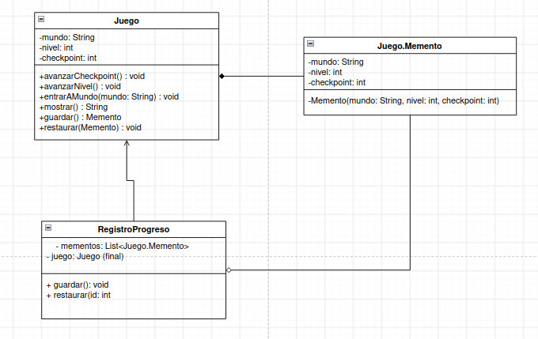

### Presentacion
https://canva.link/6wmrfl72aa8g2gr

### Estructura general


**Qué representa cada número de la figura:**

1. **La Originadora (Originator)** crea una instantánea (memento) de su estado actual y utiliza dicha instantánea para restaurar su estado cuando sea necesario.

2. **El Memento** almacena el estado interno de la originadora. Sus campos son privados e inmutables, lo que garantiza que solo la originadora pueda leerlos o modificarlos.

3. **La Cuidadora (Caretaker)** es la encargada de almacenar y custodiar el historial de mementos. Decide cuándo guardar o restaurar un estado, pero no puede acceder ni alterar el contenido interno de las instantáneas.

4. **El Cliente (Client)** solicita la creación de checkpoints y la restauración de los mismos a través del cuidador, sin manipular directamente los objetos de estado.

(El libro describe además dos variantes: una con interfaz intermedia, para lenguajes sin clases anidadas, donde la cuidadora solo ve una interfaz con metadatos del memento; y otra con encapsulación más estricta, para que ninguna otra clase acceda al estado de la originadora a través del memento. En Java la de clases anidadas es la natural.)

## El problema
 
Imagina que estás desarrollando un videojuego dividido en **mundos** (Lava, Hielo, etc.). Cada mundo tiene varios **niveles**, y dentro de cada nivel el jugador va pasando por **checkpoints**. El jugador debe poder **volver a cualquiera de esos puntos en cualquier momento**, incluso a un mundo anterior, por ejemplo cuando muere o cuando quiere repetir un nivel.
 
Esto genera varios problemas:
 
- **Encapsulación**: si el juego expusiera sus datos (`mundo`, `nivel`, `checkpoint`) con getters y setters públicos, cualquier clase externa podría alterarlos y romper una partida ya guardada.
- **Mantenimiento**: si más adelante se agrega un atributo nuevo (como vidas o inventario), habría que modificar el código de guardado en muchas partes del programa.
- **Responsabilidades**: si el propio `Juego` administrara su historial de puntos guardados, se llenaría de lógica de almacenamiento que no le corresponde.
## La solución
 

 
Se implementa el patrón **Memento** para separar el estado del juego de la gestión de su historial.
 
- **`Juego`** (originadora) conoce su estado (`mundo`, `nivel`, `checkpoint`). Con `guardar()` lo empaqueta en un `Memento` y con `restaurar()` lo aplica de vuelta.
- **`Juego.Memento`** es una clase anidada estática con campos privados e inmutables: guarda una foto del punto exacto en que se encontraba el jugador (en qué mundo, nivel y checkpoint), y solo `Juego` puede leerla.
- **`RegistroProgreso`** (cuidadora) guarda una lista de mementos y decide cuándo guardar y cuándo restaurar, sin poder ver su contenido.
Como cada memento recuerda el mundo, el nivel y el checkpoint juntos, el jugador puede saltar a **cualquier punto guardado, de cualquier mundo y en cualquier orden**, usando un solo `Juego` y un solo `RegistroProgreso`.

## Código para probar

### `Juego.java`

```java
// Originadora: produce instantaneas de su propio estado y se restaura a partir de ellas.
public class Juego {

    private String mundo;
    private int nivel;
    private int checkpoint;

    public Juego(String mundo) {
        this.mundo = mundo;
        this.nivel = 1;
        this.checkpoint = 0;
    }

    public void avanzarCheckpoint() {
        checkpoint++;//checpoint = checkpoint + 1
        //return new Memento(mundo, nivel, checkpoint); guardar partida en cada checkpoint

    }

    public void avanzarNivel() {
        nivel++;
        checkpoint = 0;
    }

    public void entrarAMundo(String mundo) {
        this.mundo = mundo;
        this.nivel = 1;
        this.checkpoint = 0;
    }


    public String mostrar() {
        return "[mundo=" + mundo + ", nivel=" + nivel + ", checkpoint=" + checkpoint + "]";
    }

    // Memento como clase anidada: la originadora accede a sus campos privados,
    // cualquier otra clase solo puede guardarlo y devolverlo, sin leerlo ni cambiarlo.
    public static class Memento {

        private final String mundo;
        private final int nivel;
        private final int checkpoint;

        private Memento(String mundo, int nivel, int checkpoint) {
            this.mundo = mundo;
            this.nivel = nivel;
            this.checkpoint = checkpoint;
        }
    }

    public Memento guardar() {
        return new Memento(mundo, nivel, checkpoint);
    }

    public void restaurar(Memento m) {
        this.mundo = m.mundo;
        this.nivel = m.nivel;
        this.checkpoint = m.checkpoint;
    }
}
```

``` java
import java.util.ArrayList;
import java.util.List;

// CUIDADORA: decide CUANDO guardar y CUANDO restaurar, pero no puede ver dentro de los mementos.
public class RegistroProgreso {

    private List<Juego.Memento> mementos = new ArrayList<>();
    private final Juego juego;

    public RegistroProgreso(Juego juego) {
        this.juego = juego;
    }

    public void guardar() {
        mementos.add(juego.guardar());
    }

    public void restaurar(int id) {
        juego.restaurar(mementos.get(id));
    }
}
```

``` java
public class App {
    public static void main(String[] args) {
        Juego juego = new Juego("Lava");
        RegistroProgreso progreso = new RegistroProgreso(juego);

        // ---------- MUNDO LAVA ----------
        progreso.guardar();                  // [0] Lava, nivel 1, checkpoint 0
        juego.avanzarCheckpoint();
        progreso.guardar();                  // [1] Lava, nivel 1, checkpoint 1
        System.out.println("Checkpoint   : " + juego.mostrar());

        juego.avanzarNivel();
        juego.avanzarCheckpoint();
        progreso.guardar();                  // [2] Lava, nivel 2, checkpoint 1
        System.out.println("Nivel 2      : " + juego.mostrar());

        // ---------- MUNDO HIELO ----------
        juego.entrarAMundo("Hielo");
        progreso.guardar();                  // [3] Hielo, nivel 1, checkpoint 0
        juego.avanzarCheckpoint();
        juego.avanzarNivel();
        juego.avanzarCheckpoint();
        juego.avanzarCheckpoint();
        System.out.println("\nActual (sin guardar): " + juego.mostrar());

        // ---------- RESTAURAR ----------
        System.out.println("\n--- Muere y vuelve al ultimo checkpoint ---");
        progreso.restaurar(3);
        System.out.println("Restaurar 3  : " + juego.mostrar());

        System.out.println("\n--- Vuelve al mundo anterior ---");
        progreso.restaurar(2);
        System.out.println("Restaurar 2  : " + juego.mostrar());
        
        // Se puede restaurar cualquier memento, en cualquier orden, las veces que quieras
    }
}
```

### Salida esperada
```
Checkpoint   : [mundo=Lava, nivel=1, checkpoint=1]
Nivel 2      : [mundo=Lava, nivel=2, checkpoint=1]

Actual (sin guardar): [mundo=Hielo, nivel=2, checkpoint=2]

--- Muere y vuelve al ultimo checkpoint ---
Restaurar 3  : [mundo=Hielo, nivel=1, checkpoint=0]

--- Vuelve al mundo anterior ---
Restaurar 2  : [mundo=Lava, nivel=2, checkpoint=1]

```


### Diferencias con otros patrones

* **Prototype:** A diferencia de Prototype (que se enfoca en clonar objetos para crear instancias nuevas), con Memento **no se crean varios juegos**, sino que se reutiliza la misma instancia del juego y solo se **cambia su estado a uno anterior** por medio de los memento.
* **Proxy de caché:** Aunque ambos guardan información en memoria, el Proxy de caché es un patrón estructural cuyo objetivo es optimizar el rendimiento evitando operaciones costosas. Memento no busca optimizar, sino gestionar un historial de estados.
* **Command:** Command trata de acciones, quién las pide, quién las ejecuta, y poder tratarlas como objetos. 
Memento trata de estado: guardarlo y devolverlo sin que nadie lo toque. Que los dos puedan servir para deshacer es una coincidencia de uso, no de propósito

